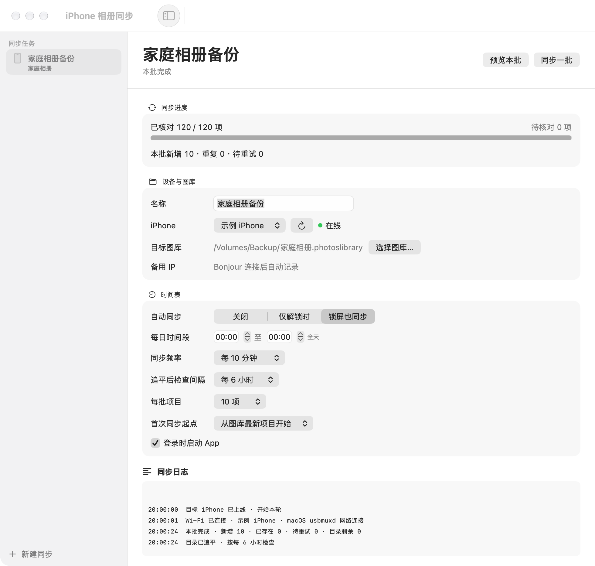

# iPhone Album Sync

[简体中文](README.md) · English

**Automatically sync iPhone photos to your Mac over the same Wi-Fi network.** During your scheduled hours, a due task imports photos and videos as soon as the paired iPhone is online. The Mac can also use Ethernet on the same LAN.

Import photos, videos and Live Photos from an iPhone into an Apple Photos library over your local network. This macOS menu bar app pairs each phone with a library you choose, including libraries on external drives. After the initial USB pairing, imports can run in the background over Wi-Fi, without opening Photos or using iCloud storage.



## Installation

If you have a project installer for your Mac’s architecture, open the `.pkg` to install the app in Applications. The installer bundles Python and its dependencies. To build from source, install the Xcode Command Line Tools and uv, then run these commands from the repository root. [Install uv](https://docs.astral.sh/uv/getting-started/installation/)

```sh
bash iPhoneSync/build.sh
open "./iPhone 相册同步.app"
```

The first local build downloads the Python dependencies. The deployment target is macOS 14 or later. Background import into a specific library has been tested on Apple silicon running macOS 27.2. Library selection relies on an undocumented PhotoKit interface. On another macOS version, try one batch with an empty test library first.

## Your first import

The app currently uses Chinese interface labels. The labels below match the ones in the app.

1. **Pair the iPhone.** Connect the unlocked phone by USB and trust the Mac when prompted. Select the phone in Finder, open **General**, enable **Show this iPhone when on Wi-Fi**, and click **Apply**. Once unplugged, the phone and Mac must be on the same local network. The Mac can use Ethernet.
2. **Choose a device and library.** Create a task, refresh the device list and select the iPhone and destination `.photoslibrary`. Mount an external library before selecting it. When prompted, allow local network access, permission to add to Photos and access to the external volume.
3. **Choose a starting point.** By default, the first batch starts near the capture time of the newest item in the destination library and works forward. If an older library has gaps, choose **指定日期** (specific date) and start early enough to cover them.
4. **Check one batch.** **预览本批** (preview batch) reads the catalogue and lists candidates without downloading originals. **同步一批** (sync one batch) retrieves and imports the files. The app compares file content for duplicates. For Live Photos it checks both the still image and the companion video.
5. **Set a schedule.** Under **时间表** (schedule), choose a mode, daily time window, interval and batch size. Closing the window leaves the app in the menu bar. Enable **登录时启动 App** (launch at login) to resume after logging in.

| Mode in the app | What it does |
| --- | --- |
| 关闭 · Off | Disables scheduled imports. Manual preview and import remain available. |
| 仅解锁时 · Only when unlocked | Checks the lock state and ends the attempt if the phone is locked or the state cannot be confirmed. The current lock-state check requires iOS 27.2 or later. |
| 锁屏也同步 · Allow while locked | When the phone is online, the app attempts to read it through the paired Apple File Conduit (AFC) service. This path does not require Developer Mode. Access depends on the services iOS makes available at the time. |

Manual preview and import use the same lock policy. Choose **锁屏也同步** to attempt a read while locked. The other modes check for an unlocked phone first.

## How scheduling works

During an enabled task’s daily window, the app subscribes to wireless device events from macOS’s `usbmuxd`. A due task starts immediately if its paired iPhone is already online. Otherwise it waits for that phone to appear. The subscription stays open across batches. Windows can span midnight, and matching start and end times mean all day. The Mac must be awake and the destination volume mounted for a batch to run.

For example, consider a task set to 10 items every 10 minutes, with a 6-hour check interval once caught up.

| Situation | What happens |
| --- | --- |
| Items remain after a batch | The next batch can start 10 minutes after the previous one started. Repeated device notifications during that interval do not start extra batches. |
| A successful batch leaves zero pending items | The task switches to its longer interval. Each task can use 1, 3, 6 or 12 hours, with a default of 1 hour. |
| A later check finds 3 new items | The task processes them in that batch and returns to 6-hour checks once caught up. |
| A later check finds 25 new items | The task processes the first 10 immediately, then uses 10-minute intervals for the remaining batches. |
| A connection or read fails, or some items need another attempt | The task uses its regular interval for the next attempt. Preview does not change the schedule. |

**目录剩余** (remaining) counts candidates still to be checked. Some may already exist in the destination. Use the completed batch’s **新增** (added) count to see how many were imported. Shared Album entries are counted separately and skipped before batching. Imports read local originals available on the device. The app does not fetch cloud-only items from iCloud.

## Connection diagnostics

**等待 iPhone 上线** means the task is due and waiting for macOS to report that phone on the network. Once a connection is attempted, the app tries the macOS wireless device connection, then Bonjour, then a previously verified local IP address if available. Each route checks the paired device’s identity. A phone can appear in Finder even when AFC cannot read its originals.

From the source directory, run the read-only check with the name of a configured task. It checks connectivity, lists `/DCIM`, and reads up to 4 KiB each from a sample photo and video when available. If only one task has a device configured, you can omit the name. The check and an active import cannot run at the same time.

```sh
./check-iphone "My backup task"
```

## Local data and issue reports

Settings, device-to-library mappings, sync progress and temporary transfers are stored under `~/Library/Application Support/iPhoneAlbumSync/`. The Mac stages the originals locally and imports them into the selected library through PhotoKit.

When reporting an issue, include the app, macOS and iOS versions, the selected mode and the step that failed. Redact device names and identifiers, network addresses, library paths and media filenames from logs or screenshots. Keep pairing records, signing keys, progress databases and personal photo libraries private.

## Packaging and licensing

```sh
bash iPhoneSync/package.sh
```

This builds a `.pkg` for the build Mac’s architecture with the runtime included. By default, local builds use the Apple Development signing identity when exactly one is available. Use `IPHONE_SYNC_SIGN_IDENTITY` for app signing, `IPHONE_SYNC_BUNDLE_ID` for the bundle identifier and `IPHONE_SYNC_INSTALLER_IDENTITY` for installer signing. Machine-specific app build settings can go in the Git-ignored `build.local.env`. Public installer distribution also requires appropriate Developer ID signing, notarization and review of bundled licenses.

The project is licensed under **GPL-3.0-or-later**. You may use, modify and redistribute its code under version 3 of the GNU General Public License or, at your option, any later version. [License text](LICENSE)

The installer includes pymobiledevice3 under GPL-3.0-or-later. Dependency versions, licenses and redistribution notes are listed in the [third-party notices](THIRD_PARTY_NOTICES.en.md).
