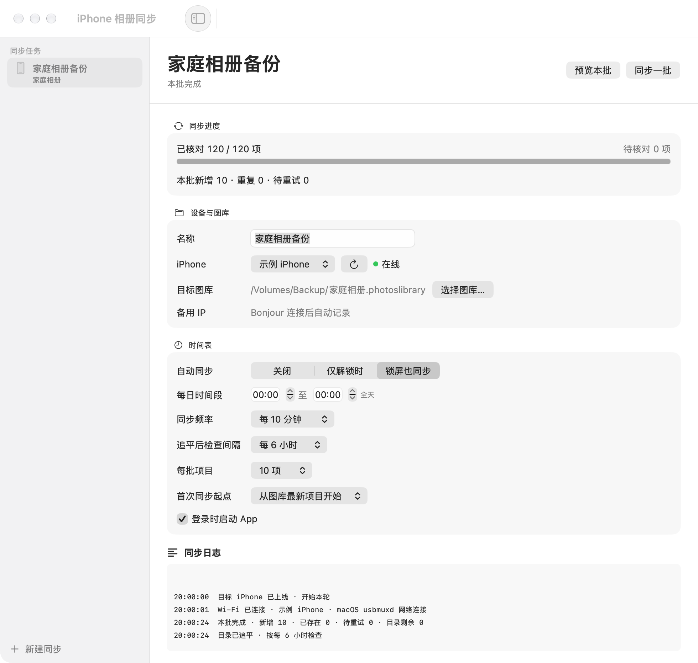

# iPhone 相册同步

简体中文 · [English](README.en.md)

**同一 Wi-Fi 下自动同步 iPhone 照片到 Mac。** 在设定时段内，只要同步到期且 iPhone 在线，App 就会自动把照片和视频导入你选定的图库。Mac 也可以通过网线接入同一个局域网。

这是一个运行在 Mac 菜单栏的照片备份工具。首次通过 USB 配对后，Mac 可以通过局域网把 iPhone 上的照片、视频和实况照片分批追加到指定的 Apple 照片图库（`.photoslibrary`）。可以给不同 iPhone 分别指定图库，也可以把图库放在外置硬盘上。日常备份无需插线、购买 iCloud 空间或打开「照片」窗口。



## 安装

如果拿到与 Mac 芯片架构匹配的项目安装包，运行 `.pkg` 即可安装到「应用程序」。这个安装包内含 Python 运行环境和依赖。也可以从源码构建：在 Mac 上安装 Xcode 命令行工具和 uv，然后在仓库根目录执行以下命令。[uv 安装说明](https://docs.astral.sh/uv/getting-started/installation/)

```sh
bash iPhoneSync/build.sh
open "./iPhone 相册同步.app"
```

本地构建首次需要联网安装 Python 依赖。构建目标为 macOS 14 及以上；指定图库的后台导入已在 macOS 27.2、Apple 芯片的 Mac 上验证。按路径选择图库用到了 PhotoKit 的非公开接口，在其他 macOS 版本上建议先用空图库试导入一批。

## 第一次备份

1. **配对 iPhone。** 用 USB 将已解锁的 iPhone 接到 Mac，按提示信任这台电脑。在访达侧边栏选择 iPhone，在「通用」中勾选「连接 Wi-Fi 时显示此 iPhone」并点「应用」。拔线后，让 iPhone 和 Mac 保持在同一局域网。Mac 可以通过以太网接入。
2. **选设备和图库。** 在 App 中新建任务，点刷新，选中对应的 iPhone 和目标图库。外置图库需要先挂载。首次访问时，按 macOS 提示允许本地网络、图库添加及外置宗卷访问。
3. **选起点。** 默认从目标图库最新照片或视频的拍摄时间附近开始，按时间从旧到新处理。如果旧图库中可能缺少更早的项目，首次运行时可选「指定日期」，把起点放到需要补齐的位置。
4. **检查一批。** 点「预览本批」查看候选项目。预览只读目录，不下载原片；点「同步一批」才会拉取并导入。导入时按文件内容判重，实况照片同时核对静态原片和配套视频。
5. **开启自动同步。** 在「时间表」选择运行模式、每日时段、频率和批量。关掉主窗口后，App 会留在菜单栏；需要重启 Mac 后继续运行时，可勾选「登录时启动 App」。

| 自动同步模式 | 行为 |
| --- | --- |
| 关闭 | 关闭定时任务，仍可手动预览或同步。 |
| 仅解锁时 | 检查 iPhone 的解锁状态；已锁定或无法确认时结束本轮。当前实现要求 iOS 27.2 或更新版本。 |
| 锁屏也同步 | 设备在线后，直接通过已配对的 AFC 文件服务尝试读取。此路径不要求开发者模式；能否读取取决于 iOS 当时开放的服务。 |

手动预览和同步也遵循锁屏策略。需要检查锁屏 iPhone 时，选择「锁屏也同步」；其余模式会先检查解锁状态。

## 定时任务如何触发

App 在已启用任务的每日时段内，向 macOS 的 `usbmuxd` 订阅无线设备上下线通知。各周期共用订阅。任务到期时，目标 iPhone 已在线就开始一批；离线就等上线通知。只有设备标识和配对关系都匹配才拉取。时段可以跨午夜，起止时间相同表示全天。Mac 需要处于唤醒状态，外置图库需要一直挂载。

以「每 10 分钟、每批 10 项、追平后每 6 小时检查」为例：

| 任务状态 | 下次怎么运行 |
| --- | --- |
| 上一批完成后仍有积压 | 从上次实际启动起满 10 分钟，设备在线时再处理一批。期间反复上下线不会重复启动。 |
| 同步成功，待核对数归零 | 切换到追平后的间隔。每个任务可选 1、3、6 或 12 小时，默认 1 小时。 |
| 追平后的检查发现 3 个新增项目 | 当轮处理这 3 项，确认归零后继续每 6 小时检查。 |
| 追平后的检查发现 25 个新增项目 | 当轮先处理 10 项，剩下的按常规 10 分钟间隔继续。 |
| 连接中断、读取失败或尚有待重试项目 | 后续按常规频率调度。预览不改变调度状态。 |

「目录剩余」表示**尚待核对的候选数**。其中可能有目标图库已经保存的文件，实际新增数量以批次完成日志为准。共享相簿目录中的项目会在分批前跳过，单独报告数量。备份范围是设备可读取的本地原片，云端独有的项目不会由此工具从 iCloud 下载。

## 连接诊断

日志中的「等待 iPhone 上线」表示任务已到期，正在等待系统登记这部无线设备。设备上线后，App 先尝试 macOS 的无线设备连接，再尝试 Bonjour；如已记住通过配对验证的局域网 IP，还可按 IP 直连。每条路径都会核对设备身份。访达侧边栏可见与 AFC 此刻能读取原片，是两项独立检查。

从源码目录运行只读检测，可检查设备连接、`/DCIM` 目录，并分别从照片和视频样本中最多读取 4 KiB。只有一个已配置设备的任务时可省略名称；多个任务请使用 App 中的唯一任务名。检测会与正在执行的同步互斥。

```sh
./check-iphone "我的备份任务"
```

## 本地数据与问题反馈

任务设置、设备与图库的对应关系、同步进度和传输暂存文件位于 `~/Library/Application Support/iPhoneAlbumSync/`。原片由 Mac 在本地暂存，通过 PhotoKit 导入目标图库。提交问题时，提供 App、macOS、iOS 版本、所选模式和出错步骤即可；需要附日志或截图时，请隐去设备名、设备标识、局域网地址、个人图库路径和媒体文件名。请勿上传配对记录、签名密钥、进度数据库或真实图库。

## 构建安装包与许可

```sh
bash iPhoneSync/package.sh
```

脚本按构建机架构生成内含运行环境的 `.pkg`。本地构建默认尝试使用唯一的 Apple Development 签名身份；签名身份、App 标识和安装包签名可分别通过 `IPHONE_SYNC_SIGN_IDENTITY`、`IPHONE_SYNC_BUNDLE_ID` 和 `IPHONE_SYNC_INSTALLER_IDENTITY` 指定。本机专用配置可放在 Git 忽略的 `build.local.env`。面向公众分发时，需另行完成 Developer ID 签名、公证及依赖许可核对。

本项目采用 **GPL-3.0-or-later**：你可以依照 GNU 通用公共许可证第 3 版，或自行选择的任何后续版本使用、修改和分发项目代码。[许可证全文](LICENSE)

发行包包含 GPL-3.0-or-later 的 pymobiledevice3；第三方组件的版本、许可证及分发说明见[第三方依赖说明](THIRD_PARTY_NOTICES.md)。
